# Guía de uso del Panel

El Panel gestiona todos los Proyectos Docker de la VPS desde el navegador: los despliega desde
GitHub, les pone dominio con certificado SSL, muestra sus logs en tiempo real y hace copias de
seguridad de su propia configuración.

Esta guía tiene dos partes:

- **Parte I — Tareas paso a paso**: lo que harás casi siempre, en orden. Si es tu primer día,
  empieza por aquí.
- **Parte II — Referencia por pantallas**: qué muestra y qué hace cada pantalla y cada opción.
  Para consultar cuando dudes de algo.

Al final hay un glosario y una tabla de estados. La guía también está en PDF: botón
«Descargar PDF» al principio de esta página.

Las capturas son de un Panel de demostración con datos inventados (clientes ACME Logística,
Tienda Mari y Estudio Norte).

# Parte I — Tareas paso a paso

## 1. Entrar y orientarse

Objetivo: entrar en el Panel y saber dónde está cada cosa.

1. Abre la dirección del Panel y entra con tu email y tu contraseña.
2. Llegas al **Dashboard**. Lo primero que ves es **Requiere atención**: los Proyectos con el
   último deploy fallido y los que se están desplegando ahora mismo. Si no hay ninguno, pone
   «Todo en orden».
3. Debajo están los contadores (Proyectos en marcha, parados y con error), los **últimos
   deploys** de todos los Proyectos y el **estado de la VPS** (base de datos, Docker, Traefik,
   certificados y backups).
4. La **barra lateral** lleva a Dashboard, Proyectos, Usuarios, Configuración, Novedades y esta
   Guía. Abajo están tu usuario, el cambio a **Modo oscuro** y «Cerrar sesión».
5. **Buscar** (o `Ctrl+K`, `⌘K` en Mac) abre una búsqueda rápida: escribe parte del nombre de
   un Proyecto, de su Cliente o de su dominio y pulsa Intro. También encuentra las páginas del
   Panel.
6. Para tener un Proyecto a mano, ábrelo y pulsa el botón de la chincheta junto a su dominio:
   aparece en **Fijados**, en la barra lateral. Los fijados se guardan en tu navegador.

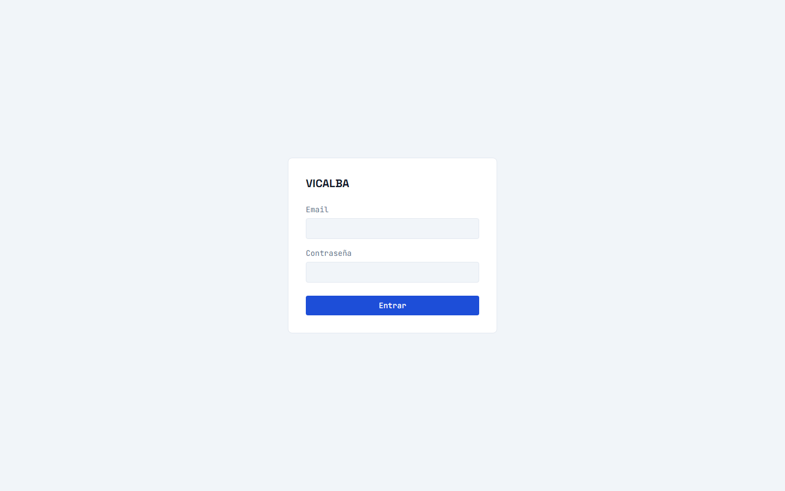

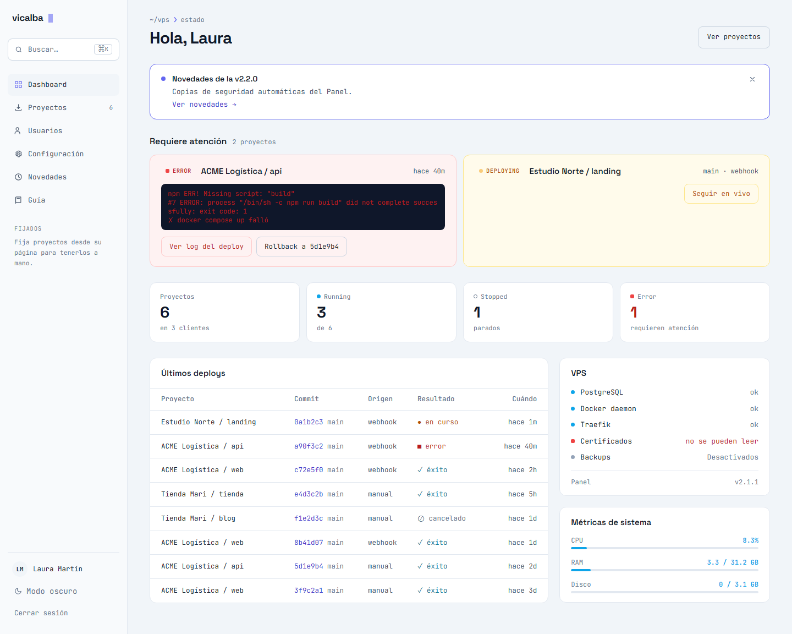

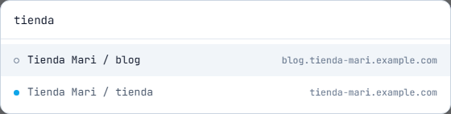

### Si algo falla

- **«Credenciales incorrectas»**: revisa el email. Tras 10 intentos fallidos en un minuto, el
  Panel bloquea los intentos desde tu conexión durante ese minuto.
- **Te saca de la sesión sin motivo**: alguien ha cambiado tu contraseña o ha eliminado tu
  usuario. Pide a otra persona del equipo que lo revise en Usuarios.

## 2. Dar de alta un Cliente y su primer Proyecto

Objetivo: crear un Cliente y un Proyecto Docker Compose que se despliega desde su repositorio.

1. Ve a **Proyectos** y pulsa **Nuevo cliente**.
2. Escribe el **slug** del Cliente (identificador corto, en minúsculas y con guiones, por
   ejemplo `panaderia-sol`) y su **nombre**. El slug no se puede cambiar después porque da
   nombre a su red Docker, `cliente-<slug>-network`: todos los Proyectos del Cliente comparten
   esa red y están aislados de los de otros Clientes.
3. Pulsa **Crear**. El Cliente aparece como una tarjeta en la lista.
4. En la tarjeta del Cliente, pulsa **+ Proyecto**.
5. Rellena:
   - **Nombre** del Proyecto (por ejemplo `web`).
   - **Tipo**: Docker Compose (el más habitual; los otros tipos se explican en la Parte II).
   - **Repositorio GitHub**: la URL del repositorio, en formato SSH
     (`git@github.com:cliente/repo.git`) o HTTPS.
   - **Rama** que se despliega (normalmente `main`).
   - **Dominio** (opcional): por ejemplo `app.cliente.com`. Traefik lo enrutará al Proyecto y
     pedirá el certificado SSL a Let's Encrypt en el primer deploy. El DNS del dominio debe
     apuntar ya a la IP de la VPS. Más dominios, paths o Servicios se añaden después en la
     pestaña **Dominios**.
   - **Puerto del contenedor** (opcional): el puerto en el que escucha la aplicación dentro
     del contenedor. Por defecto, 80. No se publica en la VPS: la aplicación solo es accesible
     a través de sus dominios.
6. Pulsa **Crear**. El Proyecto aparece en la tarjeta del Cliente, parado y sin deploys.
7. Si el repositorio es **privado**, asígnale una credencial SSH: abre el Proyecto y, en
   **Ajustes**, elige la credencial. Antes tienes que crearla en Configuración → Credenciales
   SSH y añadir su clave pública al repositorio en GitHub (Settings → Deploy keys).

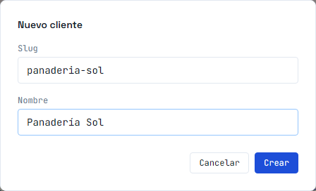

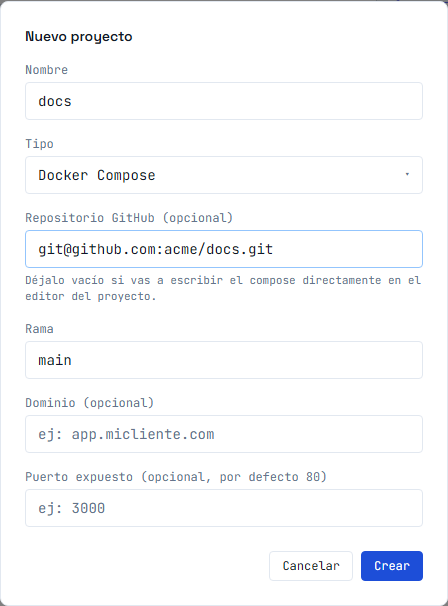

### Si algo falla

- **«El slug ya existe»**: hay otro Cliente con ese identificador; elige otro.
- **El deploy falla al clonar** («Permission denied (publickey)»): el repositorio es privado y
  el Proyecto no tiene credencial SSH, o su clave pública no está en GitHub.

## 3. Desplegar y seguir el deploy

Objetivo: poner en marcha el Proyecto con el último commit de su rama y seguir el proceso.

1. Abre el Proyecto y pulsa **Deploy** (arriba a la derecha).
2. El estado pasa a **deploying** y en **Resumen** aparece el log en vivo, dividido en fases:
   **Repositorio** (clonar o actualizar), **Checkout** (cambiar al commit), **Build y arranque**
   (construir las imágenes y levantar los contenedores) y **Red y proxy** (conectar la red del
   Cliente y Traefik).
3. Al terminar, el estado pasa a **running** y el deploy queda en la pestaña **Deploys** con su
   commit, su duración y su log completo («Ver output»).
4. Si un deploy se alarga o te has equivocado de rama, pulsa **Cancelar deploy** y confirma. El
   Proyecto vuelve al estado real de sus contenedores.
5. Un deploy que supera el tiempo máximo (Configuración → Deploys, 30 minutos por defecto) se
   cancela solo y se avisa por los canales de notificación.

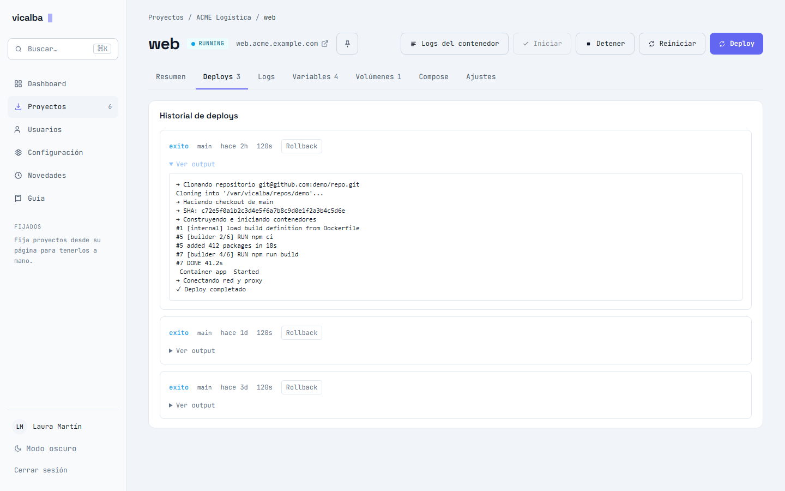

### Si algo falla

- **El deploy acaba en error**: abre su log en Deploys; las últimas líneas dicen qué falló (un
  script que no existe, una variable que falta, un error de compilación…). Corrige en el
  repositorio y vuelve a desplegar, o haz rollback (tarea 7).
- **Funciona pero el dominio no carga**: comprueba en Resumen el estado del certificado. Si pone
  «sin certificado» unos minutos después del deploy, el DNS del dominio no apunta a la VPS.

## 4. Activar el auto-deploy con el webhook de GitHub

Objetivo: que cada push a la rama del Proyecto lo despliegue solo.

1. Ve a **Configuración → Webhook de GitHub** y copia los datos que muestra.
2. En GitHub, en el repositorio: **Settings → Webhooks → Add webhook**.
   - **Payload URL**: la que muestra el Panel (`https://<dominio del Panel>/api/webhooks/github`).
   - **Content type**: `application/json`.
   - **Secret**: el `GITHUB_WEBHOOK_SECRET` del `.env` de la VPS (pídelo a quien la administra).
   - Eventos: **Just the push event**.
3. Guarda. GitHub envía un `ping`: en **Recent Deliveries** debe aparecer con respuesta 2xx.
4. En el Panel, abre el Proyecto y activa **Auto-deploy** en la tarjeta «Proyecto» del
   Resumen. Desde ese momento, cada push a su rama lanza un deploy con origen «webhook».

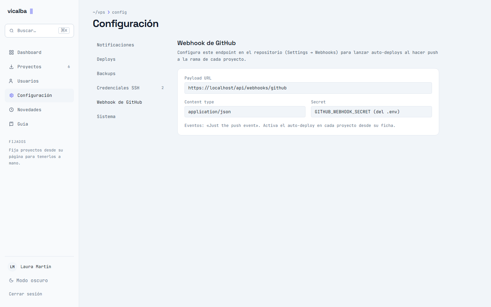

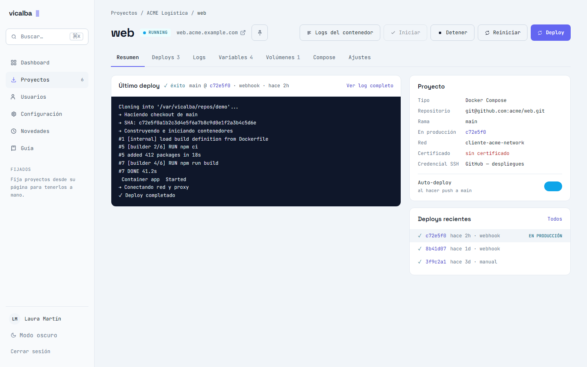

### Si algo falla

- **En Recent Deliveries no aparece nada**: GitHub no ha llamado al Panel; revisa la Payload URL.
- **Aparece con error 401**: el secret no coincide con el de la VPS.
- **Llega pero no despliega**: el push no era a la rama del Proyecto, o el Auto-deploy está
  desactivado.

## 5. Añadir variables de entorno

Objetivo: dar al Proyecto sus variables (claves de API, URL de la base de datos…).

1. Abre el Proyecto, pestaña **Variables**. Los valores se ven ocultos (`••••••••`): se guardan
   cifrados en la base de datos.
2. Pulsa **Editar variables**. Se abre un editor con todas las variables en formato `.env`, ya
   descifradas: una por línea, `CLAVE=valor`.
3. Añade, cambia o borra líneas. Para **importar un `.env`**, pega su contenido en el editor.
4. Guarda. Las variables que hayas quitado del editor se eliminan.
5. El interruptor **build** de cada variable la marca como de **build-time**: solo se usa al
   construir la imagen (por ejemplo, las `NEXT_PUBLIC_*` de Next.js) y no queda en el
   contenedor en marcha.
6. Los cambios se aplican en el **siguiente deploy**: despliega para que el Proyecto los vea.

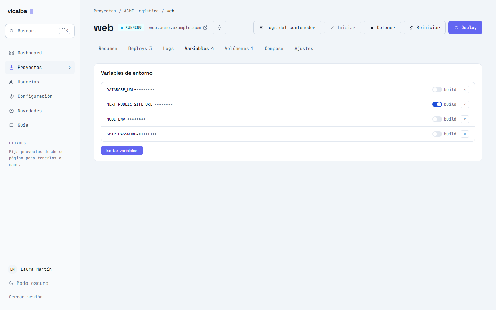

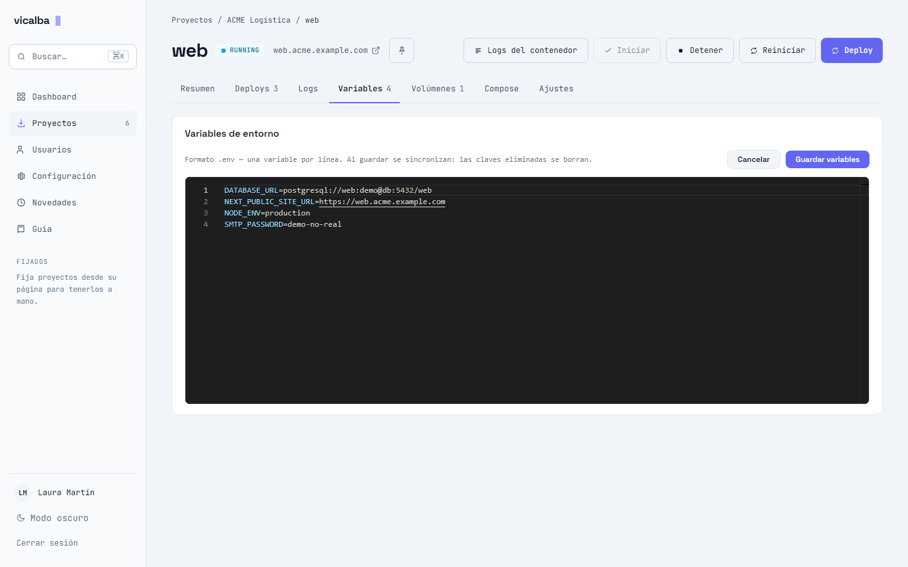

### Si algo falla

- **«Valor inválido»**: un valor no puede contener saltos de línea.
- **La aplicación no ve la variable**: falta redesplegar, o la variable es de build-time y la
  aplicación la lee en ejecución.

## 6. Ver los logs de un contenedor

Objetivo: ver en tiempo real qué está haciendo la aplicación.

1. Abre el Proyecto, pestaña **Logs** (o el botón **Logs del contenedor**, que los abre en una
   ventana grande). El indicador **Live** muestra que llegan en tiempo real.
2. Si el Proyecto tiene varios Servicios (por ejemplo `app` y `db`), elige cuál ver en el
   selector que aparece.
3. Los botones **ALL / ERR / WARN / INFO / DEBUG** filtran por nivel cuando la aplicación
   escribe sus logs en JSON (por ejemplo, con Pino). Las líneas que no son JSON se ven siempre.
4. **TS** muestra u oculta la hora de cada línea; **Auto-scroll** sigue las líneas nuevas;
   **Limpiar buffer** vacía lo que ves (no borra nada del contenedor).

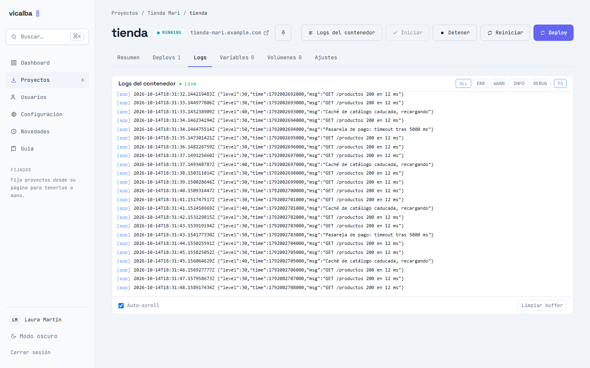

### Si algo falla

- **«El proyecto no tiene contenedores en marcha»**: está parado; pulsa **Iniciar** o despliega.
- **No llega nada**: la aplicación no escribe en la salida estándar.

## 7. Hacer rollback

Objetivo: volver al último commit que funcionaba cuando un deploy sale mal.

1. Cuando un deploy falla, el Proyecto aparece en **Requiere atención** del Dashboard con el
   final de su log y el botón **Rollback a** seguido del commit (por ejemplo `Rollback a 5d1e9b4`), que redespliega el último commit
   desplegado correctamente.
2. También puedes elegir cualquier deploy anterior: en la pestaña **Deploys**, pulsa
   **Rollback** en el que quieras.
3. El rollback es un deploy más (origen «rollback»): se ve en el historial y se puede cancelar.
4. El código del repositorio no cambia. Si el siguiente push vuelve a traer el error y el
   Auto-deploy está activo, se volverá a desplegar: corrige el repositorio.

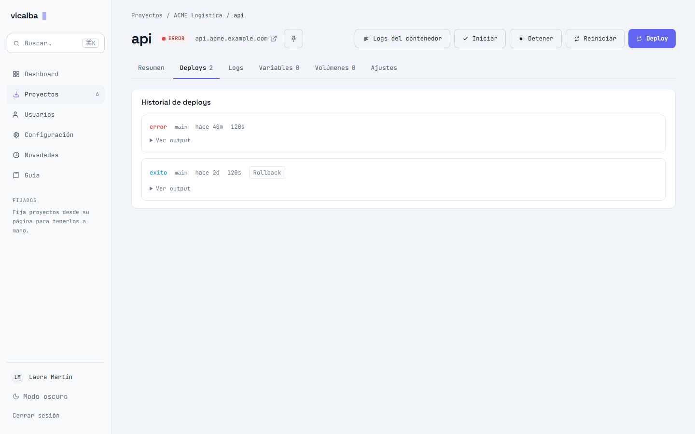

### Si algo falla

- **No aparece el botón de rollback**: no hay ningún deploy anterior correcto de ese Proyecto.

## 8. Activar los backups

Objetivo: que el Panel haga una copia diaria cifrada de su base de datos y de la configuración
de Traefik fuera de la VPS.

1. Ve a **Configuración → Backups**, tarjeta **Destino**, y elige dónde guardar las copias:
   - **S3**: cualquier almacenamiento compatible (Backblaze B2, Cloudflare R2, Hetzner, AWS…).
     Rellena el endpoint (`https://…`), el bucket (créalo antes), el prefijo si quieres una
     carpeta, el access key ID y la secret key.
   - **SFTP**: un servidor tuyo. Rellena host, puerto, usuario, ruta absoluta y la credencial
     SSH (créala antes en Credenciales SSH y añade su clave pública al servidor).
2. Pulsa **Probar y guardar**. El Panel comprueba que llega al destino, genera la clave de
   cifrado y prepara el repositorio de copias.
3. Aparece el **kit de recuperación**: el repositorio y la clave. **Cópialo y guárdalo fuera de
   la VPS** (en un gestor de contraseñas), junto con la `ENCRYPTION_KEY` del `.env` de la VPS.
   Sin los dos, si se pierde la VPS no se puede recuperar nada. Marca «He guardado el kit fuera
   de la VPS» y pulsa **Continuar**. El Panel no vuelve a mostrar el kit.
4. En **Programación**, activa **Copia diaria** y elige la hora (hora de Madrid).
5. Pulsa **Hacer copia ahora** para comprobarlo: en el **Historial** aparece la copia «En curso»
   y, en unos segundos, «Correcta».

Cada copia guarda la base de datos del Panel (Proyectos, variables, usuarios, credenciales,
historial) y la configuración de Traefik con sus certificados. Se conservan 7 copias diarias y
4 semanales. Si una copia falla, se avisa por los canales de notificación y en el Dashboard.

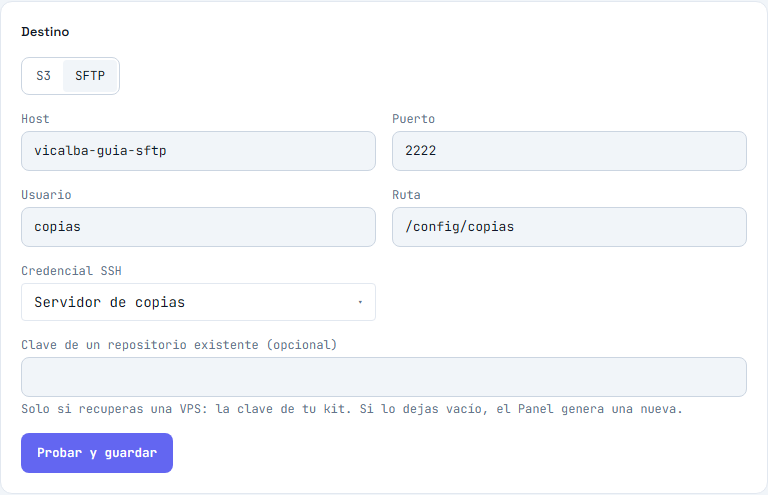

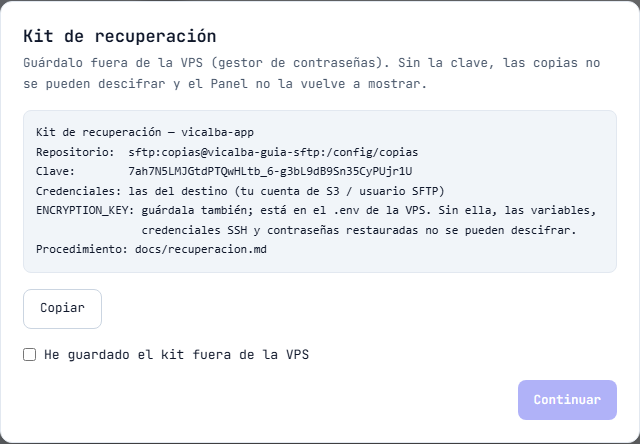

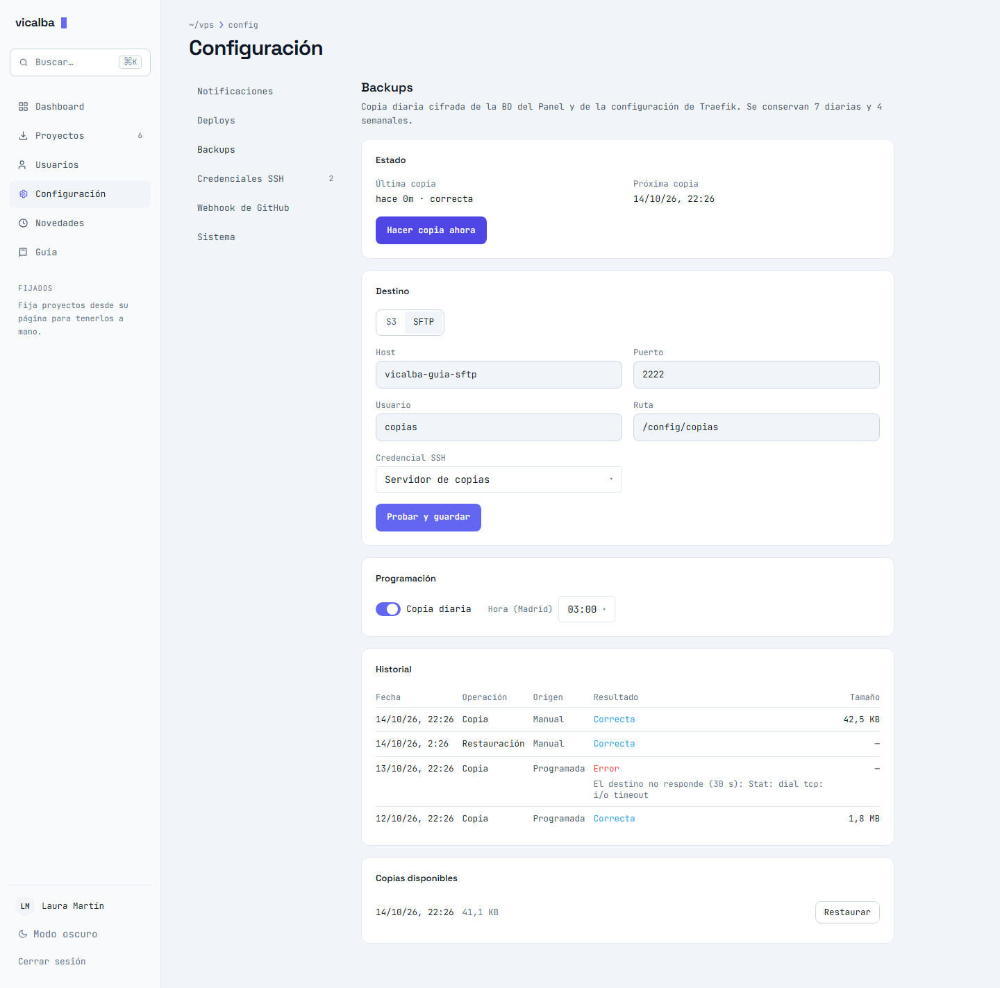

### Si algo falla

- **«El destino no responde (30 s)»**: el Panel no llega al destino. El motivo aparece detrás
  (credenciales incorrectas, bucket que no existe, host que no resuelve…).
- **«La clave no abre el repositorio existente»**: en ese destino ya hay copias cifradas con
  otra clave. Usa otro bucket o prefijo, o la clave del kit original.
- **Cambias de destino**: el Panel conserva la clave pero vuelve a mostrar el kit, porque el
  repositorio ha cambiado. Guarda el nuevo; las copias programadas esperan a que lo confirmes.

## 9. Restaurar una copia

Objetivo: devolver el Panel al estado de una copia, por ejemplo tras borrar algo por error.

1. En **Configuración → Backups → Copias disponibles** están las copias que hay en el destino,
   de la más reciente a la más antigua.
2. Pulsa **Restaurar** en la que quieras.
3. Lee el aviso: el Panel volverá a esa fecha (Proyectos, variables, usuarios, credenciales e
   historial de deploys) y se perderá lo hecho desde entonces. **Los contenedores en marcha no
   se tocan.**
4. Escribe `RESTAURAR` y confirma.
5. Antes de restaurar, el Panel hace una copia «Antes de restaurar»: si te arrepientes,
   restaura esa copia y vuelves al punto de partida.
6. La configuración de backups y su historial no retroceden: siguen como estaban.

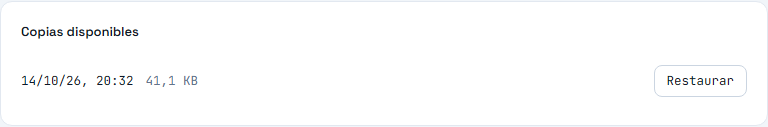

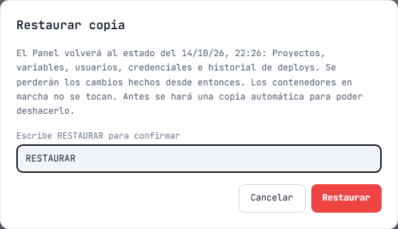

### Si algo falla

- **La restauración acaba en error y la copia previa también**: el Panel no toca la base de
  datos si no ha podido hacer antes la copia previa. Revisa el destino.
- **Has perdido la VPS entera**: esto se hace sin el Panel; ver «Recuperar el Panel en otra
  VPS», en los anexos.

# Parte II — Referencia por pantallas

## Dashboard

- **Aviso de novedades**: aparece tras actualizar el Panel; enlaza a Novedades.
- **Requiere atención**: Proyectos con el último deploy en error (con el final del log, «Ver
  log del deploy» y «Rollback a» seguido del commit) y Proyectos desplegándose («Seguir en vivo»). También
  avisa si la última copia de seguridad falló o no hay ninguna correcta en 26 horas.
- **Contadores**: Proyectos totales, en marcha, parados y con error.
- **Últimos deploys**: los más recientes de todos los Proyectos, con commit, origen (manual,
  webhook o rollback), resultado y hace cuánto.
- **VPS**: estado de PostgreSQL, Docker, Traefik, los certificados (avisa de los que caducan
  pronto) y los backups, y la versión del Panel. Debajo, el uso de CPU, memoria y disco.

## Proyectos

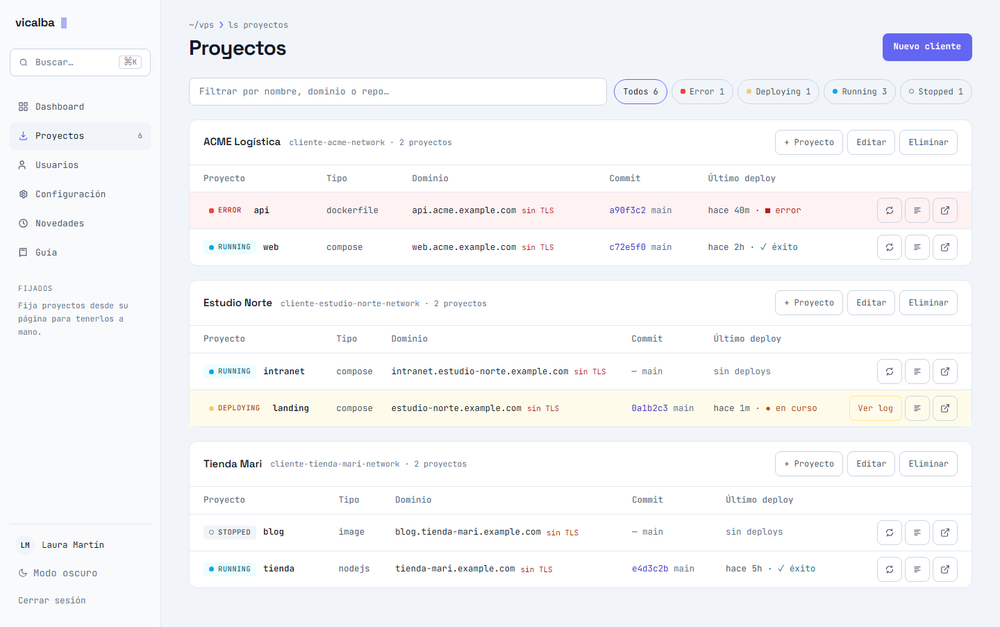

- **Filtrar**: por nombre, dominio o repositorio, y por estado (Todos, Error, Deploying,
  Running, Stopped).
- **Nuevo cliente**: abre el formulario de Cliente.
- Cada **Cliente** es una tarjeta con su red Docker y sus Proyectos. Botones: **+ Proyecto**,
  **Editar** (cambiar el nombre) y **Eliminar** (solo si no tiene Proyectos).
- Cada **fila** de Proyecto: estado, nombre (abre el detalle), tipo, dominio y si tiene
  certificado, último commit y último deploy. A la derecha: redesplegar, ver logs y abrir el
  dominio en otra pestaña. Si está desplegando, «Ver log».

## Detalle de un Proyecto

- **Cabecera**: estado, dominio (enlace), fijar en la barra lateral y las acciones **Logs del
  contenedor**, **Iniciar**, **Detener**, **Reiniciar** y **Deploy** (o **Cancelar deploy**
  mientras despliega).
- **Resumen**: el último deploy con su log, la tarjeta **Proyecto** (tipo, repositorio, rama,
  commit en producción, red, certificado, credencial SSH e interruptor de **Auto-deploy**) y los
  deploys recientes.
- **Deploys**: historial completo con su log y **Rollback** en cada uno.
- **Logs**: logs del contenedor en vivo (tarea 6).
- **Dominios**: los dominios del Proyecto. Cada uno puede llevar un path (`/api`), apuntar a
  un Servicio concreto del compose y a otro puerto, y redirigir `www` al dominio (o al revés).
  Muestra el estado del certificado, avisa si el Servicio no tiene contenedor y enseña el YAML
  que recibe Traefik. Los cambios se aplican al guardar; una ruta a un Servicio que no tenía
  ninguna funciona tras el siguiente deploy.
  En **Protección y cabeceras** cada ruta puede pedir usuario y contraseña, admitir solo
  ciertas IPs, limitar las peticiones por segundo de cada IP y el tamaño de las peticiones,
  añadir cabeceras de seguridad (HSTS, nosniff, iframes, Referrer-Policy) o propias, comprimir
  las respuestas y quitar el path antes de pasar la petición al Servicio. **Copiar protección
  de** trae la de otra ruta del Proyecto. Las contraseñas no se pueden consultar después: para
  cambiar una, escribe la nueva; si la dejas vacía, se mantiene.
- **Variables**: variables de entorno (tarea 5).
- **Volúmenes**: carpetas persistentes y su explorador.
- **Compose**: el `docker-compose.yml` del Proyecto (solo en Proyectos Docker Compose).
- **Ajustes**: editar el Proyecto (rama, puerto, credencial SSH…) y la **Zona
  peligrosa**: **Eliminar proyecto** borra el Proyecto, sus contenedores y sus datos; pide
  confirmación en dos pasos y no se puede deshacer.

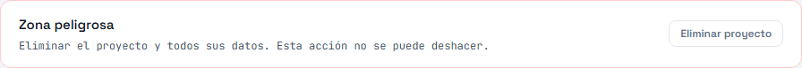

## Formulario de Proyecto

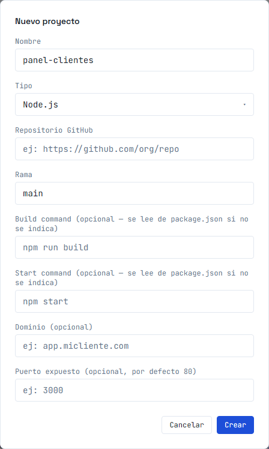

Campos comunes: **Nombre**, **Tipo**, **Dominio** (solo al crear) y **Puerto del contenedor**.
Según el tipo:

- **Docker Compose**: el repositorio contiene un `docker-compose.yml`. El repositorio es opcional:
  sin él, el compose se escribe en la pestaña Compose del Proyecto.
- **Dockerfile**: el repositorio contiene un `Dockerfile`; indica su ruta si no está en la raíz.
  El Panel genera el compose.
- **Node.js**: un proyecto Node sin Dockerfile. Indica el comando de build y el de arranque (por
  defecto, los scripts `build` y `start` de su `package.json`). El Panel genera la imagen con
  Node 22.
- **Docker Image**: una imagen ya publicada (por ejemplo `ghost:5-alpine`). No necesita
  repositorio.

## Volúmenes y explorador de ficheros

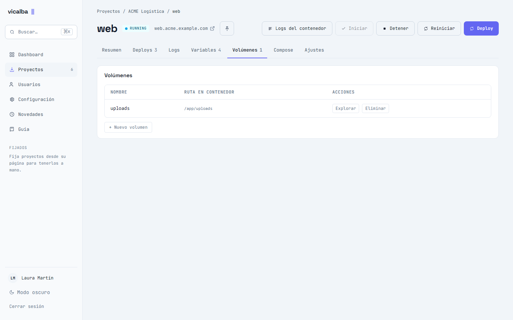

- Un **volumen** es una carpeta de la VPS montada en el contenedor: lo que se guarda en ella
  sobrevive a los deploys. Se crea con un **nombre** y la **ruta dentro del contenedor** (por
  ejemplo `/app/uploads`) y se aplica en el siguiente deploy.
- **Explorar** abre el explorador de ficheros del volumen.

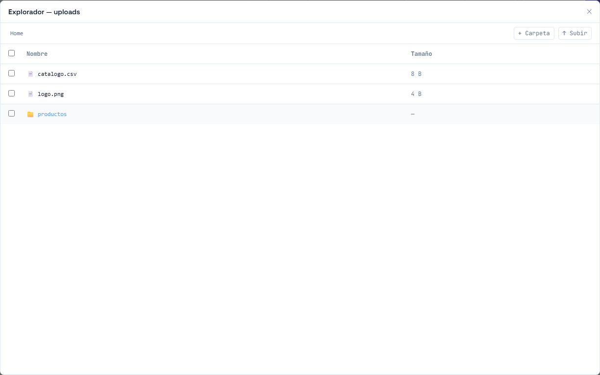

- Navega por las carpetas (el enlace «Home» vuelve a la raíz), crea carpetas (**+ Carpeta**) y
  sube ficheros (**Subir** o arrastrándolos a la ventana).
- Selecciona ficheros para **descargarlos en un ZIP** o eliminarlos.

## Editor de compose

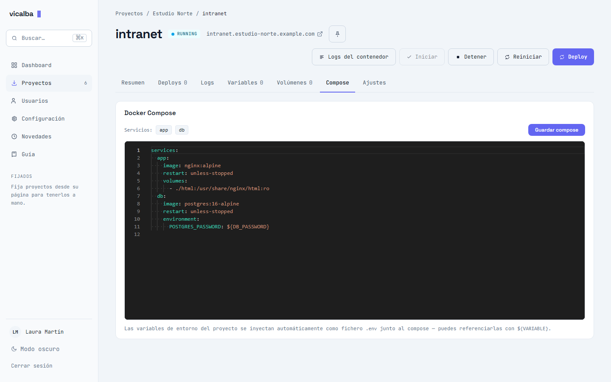

- Edita el `docker-compose.yml` del Proyecto con resaltado de YAML. Se usa en el siguiente
  deploy.
- **Recargar del repo** trae el compose del repositorio y ajusta las rutas de build para que
  funcionen desde el Panel.
- Los **Servicios** del compose aparecen en el selector de los logs.

## Configuración — Notificaciones

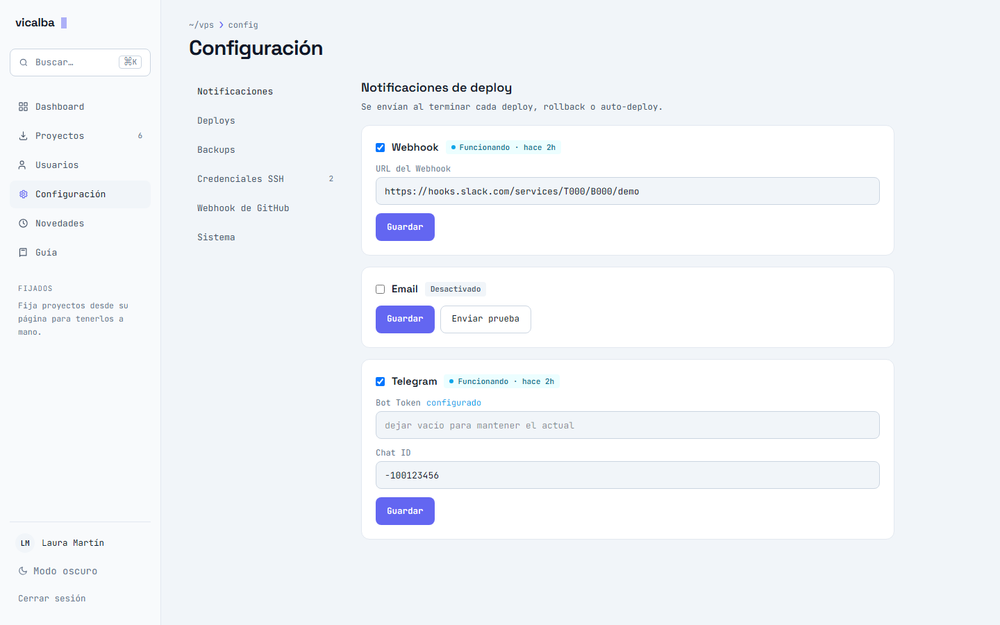

Avisos al terminar cada deploy, rollback o auto-deploy, y cuando falla una copia de seguridad.
Cada canal se activa con su casilla y muestra el resultado de su último envío.

- **Webhook**: una URL que recibe el aviso. Si es de Discord o de Slack, el mensaje sale con su
  formato.
- **Email**: servidor SMTP, puerto, usuario, contraseña, remitente y destinatario. **Enviar
  prueba** manda un correo para comprobarlo.
- **Telegram**: el token del bot y el chat ID. El token se guarda cifrado; vacío lo mantiene.

## Configuración — Deploys

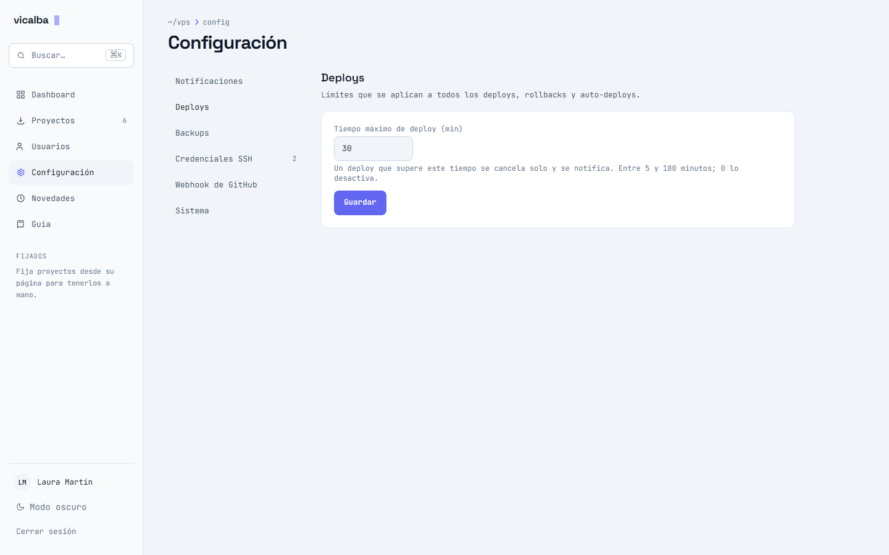

- **Tiempo máximo de deploy**: un deploy que lo supera se cancela solo y se notifica. Entre 5 y
  180 minutos; 0 lo desactiva.

## Configuración — Proxy

Ajustes de Traefik que valen para todos los Proyectos (los dominios y su protección van en la
pestaña Dominios de cada Proyecto):

- **IPs de confianza**: los proxies que haya delante de Traefik (por ejemplo los rangos de
  Cloudflare). Solo de ellos se aceptan las cabeceras `X-Forwarded-*`; vacío, Traefik es la
  entrada y pone él la IP real del visitante.
- **Timeouts** de lectura, escritura e inactividad, en segundos (0 = sin límite).
- **Nivel de log**, **TLS mínimo** (1.2 o 1.3) y **Access log** (una línea por petición; actívalo
  solo para depurar, con tráfico tapa los errores).

**Aplicar** reinicia Traefik: se cortan las conexiones unos segundos y el Panel puede no
responder mientras tanto; la página espera y muestra el resultado. Si Traefik no arranca con la
nueva configuración, se vuelve sola a la anterior y se enseña el motivo con el log de Traefik.
**Ver las últimas líneas del log de Traefik** ayuda a depurar.

Si aun así no se puede entrar al Panel, hay un **acceso de emergencia** que no pasa por Traefik:
`ssh -L 3000:localhost:3000 usuario@vps` y abre `http://localhost:3000`.

## Configuración — Backups

- **Estado**: última copia (hace cuánto y si fue correcta, o el motivo del fallo), próxima copia
  y **Hacer copia ahora**.
- **Destino**: S3 o SFTP y sus datos; **Probar y guardar** (tarea 8).
- **Programación**: copia diaria y hora.
- **Historial**: cada copia y restauración con su fecha, origen (programada, manual o antes de
  restaurar), resultado y tamaño.
- **Copias disponibles**: las copias que hay en el destino y **Restaurar** (tarea 9).

## Configuración — Credenciales SSH

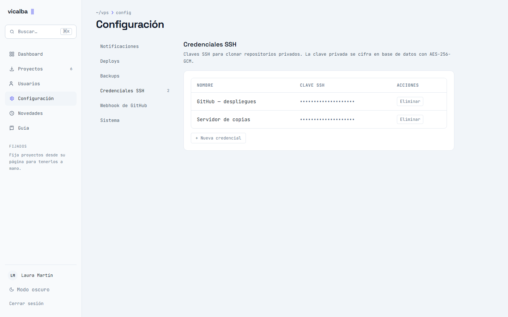

- Claves SSH para clonar repositorios privados y para el destino SFTP de los backups. La clave
  privada se guarda cifrada.
- Crea una credencial con su nombre, su clave pública y su clave privada; añade la pública al
  repositorio de GitHub (Deploy keys) o al servidor SFTP.

## Configuración — Webhook de GitHub

- Los datos para configurar el webhook en cada repositorio: Payload URL, content type y secret
  (tarea 4).

## Configuración — Sistema

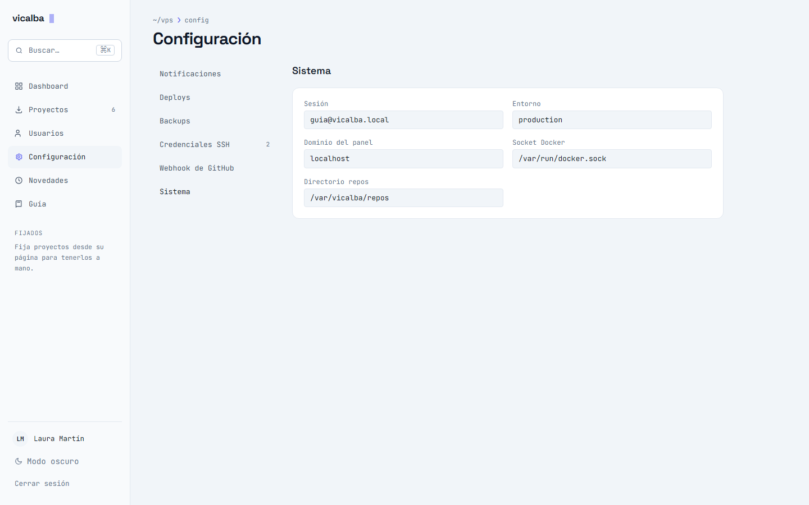

- Tu sesión, el entorno, el dominio del Panel, el socket de Docker y la carpeta de los
  repositorios. Solo informativo.

## Usuarios

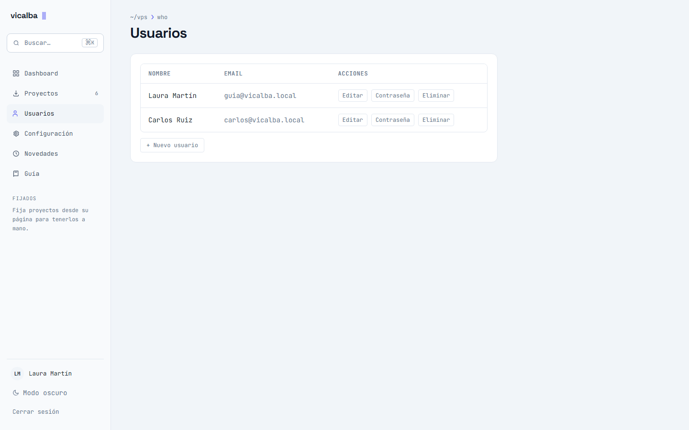

- Las personas que pueden entrar en el Panel: crear, editar, cambiar la contraseña y eliminar.
- Al cambiar la contraseña de un usuario o eliminarlo, se cierran al momento sus sesiones
  abiertas.

## Novedades

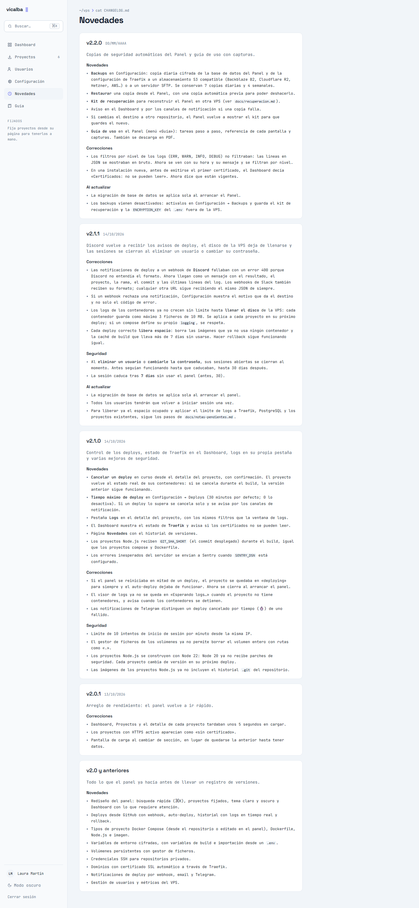

- Qué ha cambiado en cada versión del Panel, de la más reciente a la más antigua.

# Anexos

## Glosario

- **Panel**: esta aplicación.
- **VPS**: el servidor donde corren el Panel y todos los Proyectos.
- **Cliente**: quien contrata los servicios. Tiene uno o más Proyectos y nunca entra en el
  Panel.
- **Proyecto**: una aplicación de un Cliente que se despliega en la VPS.
- **Servicio**: cada contenedor de un Proyecto (por ejemplo `app` y `db`).
- **Red de proyecto**: la red Docker de un Cliente (`cliente-<slug>-network`); aísla sus
  Proyectos de los de otros Clientes.
- **Deploy**: desplegar o redesplegar un Proyecto desde su repositorio.
- **Auto-deploy**: deploy automático al hacer push a la rama del Proyecto.
- **Rollback**: redesplegar un commit anterior.
- **Proxy**: Traefik, que recibe las visitas y las envía al Proyecto de cada dominio.
- **Dominio**: el nombre con el que se visita un Proyecto.
- **Certificado**: el certificado SSL de un dominio, que Let's Encrypt emite y renueva solo.
- **Backup**: una copia de seguridad del Panel.
- **Kit de recuperación**: el repositorio y la clave de las copias; con él y la
  `ENCRYPTION_KEY` se recupera el Panel en otra VPS.
- **Restauración**: devolver el Panel al estado de una copia.

## Estados y colores

| Estado      | Qué significa                                                 |
| ----------- | ------------------------------------------------------------- |
| `running`   | Los contenedores del Proyecto están en marcha.                |
| `stopped`   | El Proyecto está parado (nunca desplegado o detenido a mano). |
| `deploying` | Se está desplegando ahora mismo.                              |
| `error`     | El último deploy falló.                                       |

Resultados de un deploy: **éxito**, **error**, **cancelado** (a mano o por superar el tiempo
máximo) y **en curso**. Resultados de una copia o restauración: **Correcta**, **Error** y **En
curso**.

## Recuperar el Panel en otra VPS

Si se pierde la VPS, el Panel se reconstruye en otra a partir de las copias, sin necesidad del
Panel antiguo. Hace falta:

- el **kit de recuperación** (repositorio y clave),
- las credenciales del destino (la cuenta de S3 o el acceso SFTP),
- la **`ENCRYPTION_KEY`** del `.env` original.

El procedimiento paso a paso está en `docs/recuperacion.md` del repositorio: preparar la VPS,
descargar la última copia con restic, restaurar la base de datos y la configuración de Traefik,
arrancar el Panel y redesplegar cada Proyecto.
